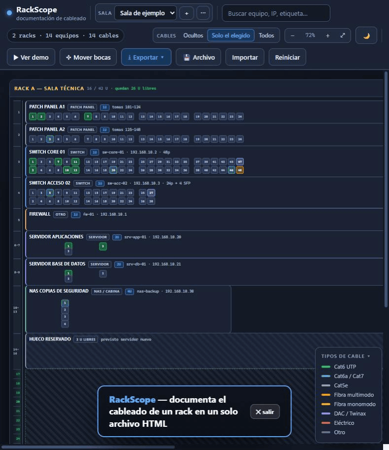

*[Español](README.md) · **English***

# RackScope

**Document your rack cabling in a single HTML file.** No server, no install, no dependencies — and nothing ever leaves your machine.

Which port goes to which port, with what cable and what notes. One `index.html` you open by double-clicking it in any browser.

It was born out of a very specific problem: with several patch panels and a pile of tangled patch cords, finding where one cable ends means following it by eye or pulling on it and hoping. Here it takes one click.

Every device is defined with the port count it actually has, from 1 to 96: 12, 16, 24, 32 or 48-port panels, switches with their SFP cages, servers with four NICs, or a recorder with a single port.

It has a sister tool, **[SubnetScope](https://github.com/marcosblg/subnetscope)**, to plan the network's IPs and VLANs: send it the devices you document here, assign their IPs there and then bring those IPs back into RackScope. [Try it](https://marcosblg.github.io/subnetscope/).

And a third one, **[AssetScope](https://github.com/marcosblg/assetscope)**, for inventory: what each device is, its serial number and when its warranty or support runs out. It imports RackScope devices with their room, rack and U. [Try it](https://marcosblg.github.io/assetscope/).

And a fourth one, **[CertScope](https://github.com/marcosblg/certscope)**, for TLS certificates and domains: paste the PEM and it warns you before they expire. [Try it](https://marcosblg.github.io/certscope/).

### 👉 [Try it right now in your browser](https://marcosblg.github.io/rackscope/)

🌐 **In English and Spanish**: it opens in your browser's language and the **EN / ES** button switches it.

> 🆕 **v2.4** (October 16, 2026): now in English too. On top of v2.3: a custom label for every port, a background colour per device, and choosing the starting U when you add one. Following v2.2: deleting a device no longer shifts the rack, undo with Ctrl+Z, and exports that do not reveal the whole cabling. [See all the changes](CHANGELOG.md)

Nothing to install or download: the link opens the tool with a sample room. Hit **▶ Ver demo** for the guided tour.

🎬 **[Watch the demo video (30 s)](docs/demo.mp4)** · or hit **▶ Ver demo** inside the app to walk through it yourself.

## What it does

**Document the cabling**
- Click one port, click another: the cable is drawn between them.
- Every connection carries a cable type (Cat5e, Cat6, Cat6a/7, multimode fiber, single-mode fiber, DAC/Twinax, power), a short label and a free-form note.
- **A custom label for every port**: the patch panel port carries the same name as the wall socket it reaches. It shows in the port card, in the search box and in the exports.
- **Click any port and it tells you instantly where it goes**: device, exact port number, rack, cable type and your note. No tracing cables by eye.
- Hovering already pops up a quick hint with the destination.
- The port window can be dragged by its header: while connecting it shrinks, and if it covers the destination port you just move it aside.
- Used ports are painted in their cable's color, so free capacity is obvious at a glance.
- Cables can be hidden, shown only for the selected port, or all at once — so the screen never turns into spaghetti.

**Draw the rack as it actually is**
- Every device with its real port count, as a strip, a grid, or placed **by hand** wherever you want.
- Horizontal numbering (1…24) or vertical (1-2 / 3-4, like real switches), with gaps between blocks and an odd-bottom / even-top option.
- **Separate SFP ports** with their own numbering (S1, S2…), to the right or left of the regular block.
- **Custom device types** (router, PBX, KVM…) with their own name and color.
- Variable width and height: 1U bars, 2U servers, square arrays, several boxes side by side in one row.
- Tools to line ports up: multi-select with Ctrl/Shift, marquee selection, group drag, align, distribute, pack, sort by number and arrow-key nudging. Whatever does not fit in one row wraps to the next one, without stacking ports.
- Undo and redo with Ctrl+Z / Ctrl+Y.
- Change each rack's width by dragging its right edge.

**Know what fits**
- A U ruler down the left of each rack, showing the range each device occupies.
- Free U are drawn and counted: *"18 / 42 U · 24 U free"*.
- **Blank panel** elements to reserve space exactly where it really is; they count as free U.
- **＋ rack** creates an empty rack or **copies any existing one**, from this room or another, including its internal cables.

**Multiple rooms**
- A room selector: each one with its own racks, devices and cables.
- **Cables between rooms**: hit *Conectar esta boca…* (connect this port), switch rooms in the selector and pick the destination. The port shows a ↗ mark and its card takes you to the other room.

**Teamwork**
- If several people use the same `.json` in a **shared network folder**, everyone sees the others' changes within seconds, and if two people save at once the app warns instead of overwriting.
- Optional **server mode** for Apache with PHP: copy `index.html` and `rackscope.php` to the server and the whole team works on the same plan from their browsers. See **[SERVIDOR.md](SERVIDOR.md)** (in Spanish).

**Get the documentation out**
- **PNG** or **SVG** image of the whole layout.
- **PDF** with the overview, one page per rack, the connection table and a per-rack inventory with U usage.
- Choose which cables appear in images and PDF (none, only between racks, only to other rooms, only fiber or only copper) so you do not reveal all your cabling.
- **CSV** for Excel with every connection.
- **JSON** backup.
- Any of them for one room or for all of them at once.

## How to use it

1. Download `index.html` and double-click it.
2. Hit **▶ Ver demo** for a 30-second guided tour.
3. It ships with a sample room to play with. When you want to start for real: **＋** in the room selector → *en blanco* (blank).
4. Hit **💾 Archivo** and pick a `.json` of your own: from then on the app rewrites it every time you change something.

## Where the data lives

In server mode, on your server (see [SERVIDOR.md](SERVIDOR.md)). Otherwise, on your machine and nowhere else. No server, no account, not a single network request. It is stored in the browser's local storage and, if you link a file, in that `.json` you chose.

One important caveat: browser storage is tied to the file's path. Move the HTML or download another copy into a different folder and that storage does not follow. So link a file, or export the JSON now and then. The app shows a red warning if it detects the browser will not let it save.

## Compatibility

Tested on Chromium-based browsers (Chrome and Edge). Automatic file saving uses the File System Access API; where that is unavailable, everything still works through JSON export and import.

Note: the interface is in Spanish.

## Status

A personal project, built to solve a real problem at work. Published in case it helps someone else. Suggestions welcome — open an issue describing what you would need.

## License

AGPL-3.0. Use it and modify it freely, including inside your company. If you distribute a modified version or offer it as a service, you must publish the source under this same license. Versions before v2.3 were released under MIT and remain so.

The **RackScope** name and visual identity are not covered by the code license: if you publish a derivative, give it a different name.

**Using it at work?** If you need a license that does not require publishing your code, or support, get in touch on LinkedIn: https://es.linkedin.com/in/marcos-belmonte-gomez-9b5a71205
