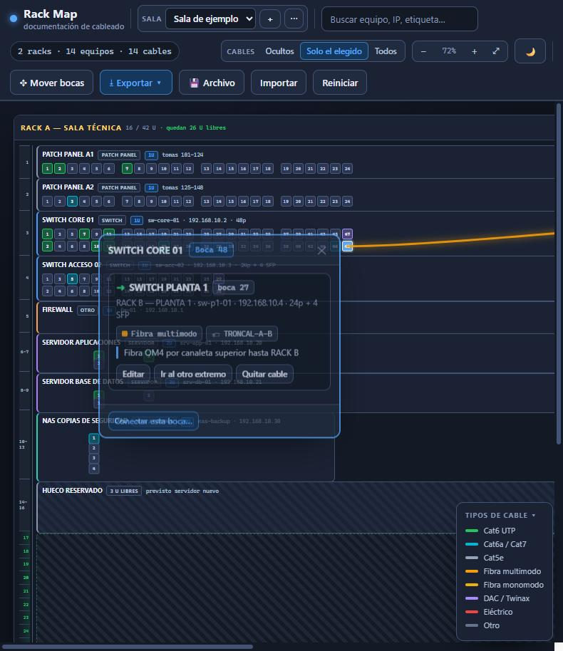

***Español** · [English](README.en.md)*

# RackScope

**Documenta el cableado de tus racks en un solo archivo HTML.** Sin servidor, sin instalación y sin que salga un dato de tu equipo.

Qué boca va a qué boca, con qué cable y con qué notas. Un único archivo `index.html` que se abre con doble clic en cualquier navegador.

Nació de un problema muy concreto: con varios paneles de parcheo y un montón de latiguillos mezclados, saber a dónde va un cable concreto obliga a seguirlo con la vista o a tirar de él. Aquí se resuelve con un clic.

Cada equipo se define con el número de bocas que tenga de verdad, de 1 a 96: paneles de 12, 16, 24, 32 o 48, switches con sus SFP, servidores con cuatro tarjetas o un grabador con una sola boca.

Tiene una herramienta hermana, **[SubnetScope](https://github.com/marcosblg/subnetscope)**, para planificar las IPs y VLANs de la red: le pasas los equipos que documentes aquí, les das IP allí y luego devuelves esas IPs a RackScope. [Pruébala](https://marcosblg.github.io/subnetscope/).

Y una tercera, **[AssetScope](https://github.com/marcosblg/assetscope)**, para el inventario: qué es cada equipo, su número de serie y cuándo vence su garantía o su soporte. Se trae los equipos de RackScope con su sala, rack y U. [Pruébala](https://marcosblg.github.io/assetscope/).

Y una cuarta, **[CertScope](https://github.com/marcosblg/certscope)**, para los certificados TLS y los dominios: pegas el PEM y te avisa antes de que caduquen. [Pruébala](https://marcosblg.github.io/certscope/).

### 👉 [Pruébalo ahora en el navegador](https://marcosblg.github.io/rackscope/)

🌐 **En español y en inglés**: sale en el idioma de tu navegador y se cambia con el botón **EN / ES**.

> 🆕 **v2.4** (16 de octubre de 2026): ahora también en inglés. Viene de la v2.3: etiqueta propia para cada boca, color de fondo por equipo y elegir en qué U empieza un equipo al añadirlo. Viene de la v2.2: borrar sin descolocar el rack, deshacer con Ctrl+Z y exportaciones sin enseñar todo el cableado. [Ver todas las novedades](CHANGELOG.md)

No hay que instalar ni descargar nada: el enlace abre la herramienta con una sala de ejemplo. Pulsa **▶ Ver demo** para la visita guiada.

🎬 **[Ver el vídeo de demostración (30 s)](docs/demo.mp4)** · o pulsa **▶ Ver demo** dentro de la propia aplicación para recorrerla tú mismo.

## Qué hace

**Documentar el cableado**
- Clic en una boca y clic en otra: queda el cable dibujado entre ambas.
- Cada conexión lleva tipo de cable (Cat5e, Cat6, Cat6a/7, fibra multimodo, fibra monomodo, DAC/Twinax, eléctrico), etiqueta corta y una nota libre.
- **Clic en cualquier boca y te dice al instante a dónde va**: equipo, número de boca exacto, rack, tipo de cable y la nota. Sin seguir el cable con la vista.
- **Etiqueta propia para cada boca**: la boca del patch panel se llama igual que la roseta a la que llega. Sale en su ficha, en el buscador y en las exportaciones.
- Al pasar el ratón por encima ya sale un aviso rápido con el destino.
- La ventana de la boca se arrastra por su cabecera: al conectar se reduce y, si tapa la boca de destino, la apartas.
- Las bocas ocupadas se pintan del color del tipo de cable, así ves de un vistazo qué está libre.
- Los cables se pueden ocultar, ver solo el de la boca elegida o verlos todos, para que la pantalla no se convierta en una maraña.

**Dibujar el rack como es en realidad**
- Cada equipo con su número real de bocas, en tira, en rejilla o colocadas **a mano** donde te dé la gana.
- Numeración horizontal (1…24) o vertical (1-2 / 3-4, como los switches reales), con separación por bloques y opción de impares abajo y pares arriba.
- **Bocas SFP aparte** con su propia numeración (S1, S2…), a la derecha o a la izquierda del bloque normal.
- **Tipos de equipo propios** (router, centralita, KVM…) con su nombre y su color.
- Cajas de ancho y alto variable: barras de 1U, servidores de 2U, cabinas cuadradas, varias cajas en la misma fila, cada una con su **color de fondo** si quieres.
- Al añadir un equipo eliges **en qué U empieza**: el espacio que quede por encima pasa a ser hueco libre, y si cae dentro de un hueco reservado, el hueco se parte.
- Herramientas para cuadrar bocas: selección múltiple con Ctrl/Shift, selección por recuadro, mover en grupo, alinear, repartir, juntar, ordenar por número y ajuste fino con las flechas. Lo que no cabe en una fila pasa a la siguiente, sin montar unas bocas sobre otras.
- Deshacer y rehacer con Ctrl+Z / Ctrl+Y.
- El ancho de cada rack se cambia arrastrando su borde derecho.

**Saber qué te cabe**
- Regla de U a la izquierda de cada rack, con el rango que ocupa cada equipo.
- Las U libres se dibujan y se cuentan: *"18 / 42 U · quedan 24 U libres"*.
- Elementos de tipo **hueco libre** para reservar espacio donde de verdad está; cuentan como U libres.
- **＋ rack** crea uno vacío o **copia cualquier rack existente**, de esta sala o de otra, con sus cables internos.

**Varias salas**
- Desplegable de salas: cada una con sus racks, equipos y cables.
- **Cables entre salas**: pulsa *Conectar esta boca…*, cambia de sala en el desplegable y elige el destino. La boca lleva la marca ↗ y desde su ficha saltas a la otra sala.

**Trabajar en equipo**
- Si varias personas usan el mismo `.json` en una **carpeta de red**, cada una ve los cambios de las demás en unos segundos y, si dos guardan a la vez, la aplicación avisa en vez de pisar nada.
- **Modo servidor** opcional para Apache con PHP: copias `index.html` y `rackscope.php` en el servidor y todo el equipo trabaja sobre el mismo plano desde su navegador. Instrucciones en **[SERVIDOR.md](SERVIDOR.md)**.

**Sacar la documentación fuera**
- Imagen **PNG** o **SVG** del plano completo.
- **PDF** con el plano general, una página por rack, la tabla de conexiones y el inventario por rack con sus U.
- Puedes elegir qué cables salen en las imágenes y el PDF (ninguno, solo entre racks, solo a otras salas, solo fibra o solo cobre) para no enseñar todo el conexionado.
- **CSV** para Excel con todas las conexiones.
- **JSON** de copia de seguridad.
- Todo ello de una sala o de todas a la vez.

## Cómo se usa

1. Descarga `index.html` y ábrelo con doble clic. También puedes probarlo sin descargar nada desde la demo en línea.
2. Pulsa **▶ Ver demo** para una visita guiada de 30 segundos por las funciones.
3. Viene con una sala de ejemplo para trastear. Cuando quieras empezar en serio: **＋** en el desplegable de salas → *en blanco*.
4. Pulsa **💾 Archivo** y elige un `.json` tuyo: a partir de ahí la aplicación lo reescribe sola cada vez que cambias algo.

## Dónde se guardan los datos

Si usas el modo servidor, en tu servidor (ver [SERVIDOR.md](SERVIDOR.md)). Si no, en tu equipo y en ningún sitio más. No hay servidor, no hay cuenta y no sale una sola petición a Internet. Se guarda en el almacenamiento local del navegador y, si vinculas un archivo, en ese `.json` que eliges tú.

Un aviso importante: el almacenamiento del navegador va atado a la ruta del archivo. Si mueves el HTML o te descargas otra copia en otra carpeta, ese almacén no viaja contigo. Por eso conviene vincular un archivo o exportar el JSON de vez en cuando. La aplicación avisa en rojo si detecta que el navegador no le deja guardar.

## Compatibilidad

Probado en navegadores basados en Chromium (Chrome y Edge). El guardado automático en archivo usa la File System Access API; donde no esté disponible, funciona igual con exportar e importar JSON.

## Estado

Proyecto personal, hecho para resolver un problema real de trabajo. Se publica por si le sirve a alguien más. Las sugerencias son bienvenidas: abre un *issue* contando qué necesitarías.

## Licencia

AGPL-3.0. Puedes usarlo y modificarlo libremente, también dentro de tu empresa. Si distribuyes una versión modificada o la ofreces como servicio, tienes que publicar el código con esta misma licencia. Las versiones anteriores a la v2.3 se publicaron bajo MIT y siguen siéndolo.

El nombre **RackScope** y su identidad visual no entran en la licencia del código: si publicas un derivado, ponle otro nombre.

**¿Lo usáis en vuestra empresa?** Si necesitáis una licencia que no obligue a publicar vuestro código, o soporte, escribidme por LinkedIn: https://es.linkedin.com/in/marcos-belmonte-gomez-9b5a71205
